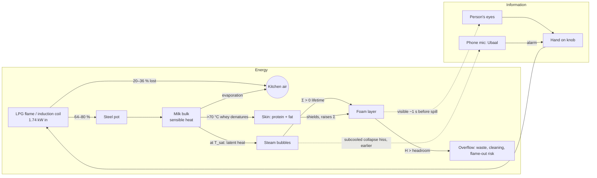

# Deconstruction (rubric step 2): components, flows, losses, interactions

## System boundary
Inside: burner/hob, pot, milk (water, fat, casein, whey, lactose), surface skin, vapour, foam, the person, and (after the rebuild) the phone.
Outside: kitchen air (sink for heat loss and steam), the room the person is in, the milk packet.

## Where time, effort, material, energy and information are lost
| Flow | Loss | Size | Source |
|---|---|---|---|
| Energy | Burner → pot inefficiency | 32–36 % on LPG; ~20 % induction | [R36][R37] |
| Energy | Heat after spill (flame-out, re-heating) | **TO MEASURE** | — |
| Material | Spilled milk | **TO MEASURE** (mL) | trial log |
| Effort | Cleaning stove and pot | **TO MEASURE** (min) | trial log |
| Time / attention | Standing at the stove for the whole heat-up | ~3 min per boil (model). Indian households boil daily [R14] | model + [R14] |
| Information | Visual cue arrives ~1 s before overflow | Magnify T1 | calculation |
| Safety | Flame put out by the spill → gas leak if no FFD | qualitative | [R38] |

## Process map (current vs rebuilt)
**Current:** pour milk → light stove → *stand and watch for ~3 min* → foam appears → rush to turn the knob → (often) spill → clean.
**Rebuilt (Ubaal):** pour milk → open Ubaal, press Start (8 s calibration) → light stove → *leave* → alarm "turn to sim" → turn the knob → milk reaches a full boil without spilling → switch off.

## Photo / diagram checklist for slide 2 (see 09_HOME_TRIAL_KIT/TRIAL_PROTOCOL.md)
Exploded view of pot, milk, skin and foam layers. Three baseline frames. The process map above, drawn neatly.
